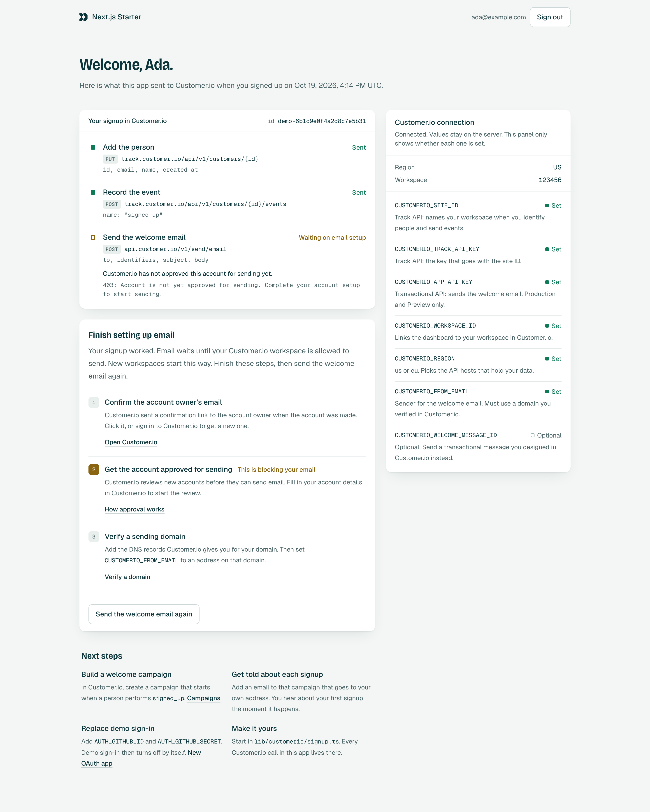

# Customer.io Next.js Starter

A Next.js starter with sign-in, a small dashboard, and Customer.io set up on the server.

When someone signs up, the app:

1. adds them to Customer.io as a person (`identify`),
2. records a `signed_up` event, and
3. sends a welcome email with the Transactional API.

A brand-new Customer.io workspace cannot send email yet. The starter handles that: signup still works, and the dashboard shows a short checklist to finish email setup.

[](https://vercel.com/new/clone?repository-url=https%3A%2F%2Fgithub.com%2Fcustomerio%2Fvercel-nextjs-starter&integration-ids=oac_PLACEHOLDER&env=AUTH_SECRET&envDescription=A%20random%20secret%20that%20encrypts%20sessions.%20Run%20%60npx%20auth%20secret%60%20or%20%60openssl%20rand%20-base64%2033%60.&envLink=https%3A%2F%2Fauthjs.dev%2Fgetting-started%2Finstallation%23setup-environment&project-name=customerio-nextjs-starter&repository-name=customerio-nextjs-starter)

**Demo:** `DEMO_URL_PLACEHOLDER`

| Landing page                                  | Dashboard                                    |
| --------------------------------------------- | -------------------------------------------- |
|  |  |

<!-- Screenshots: run `pnpm screenshots` (see scripts/screenshots.mjs) and copy the ones you want to docs/screenshots/. -->

## What is inside

- **Next.js 16** with the App Router and TypeScript.
- **Auth.js** for sign-in. GitHub when you add an OAuth app, and a demo sign-in until then.
- **Customer.io** through [`customerio-node`](https://github.com/customerio/customerio-node): the Track API for people and events, the App API for transactional email. All calls run on the server.
- **Tailwind CSS**, light and dark mode.
- **No database.** Sessions live in an encrypted cookie.

## Deploy

1. Click **Deploy with Vercel** above.
2. Vercel asks you to add the **Customer.io integration**. It connects a Customer.io workspace and writes the `CUSTOMERIO_*` variables into your project.
3. Vercel asks for **`AUTH_SECRET`**. Paste a random value. Make one with:

   ```sh
   npx auth secret        # prints a value, and writes it to .env.local
   # or
   openssl rand -base64 33
   ```

4. Open your new site and sign up with the demo sign-in. Then open your workspace in Customer.io: you are there as a person, with a `signed_up` event.

That is the only value you type by hand. Everything else is optional.

## How it works

```
Sign-in form ──▶ Auth.js (server action or OAuth callback)
                    │
                    └─ events.signIn  (auth.ts)
                         │
                         ├─ first sign-in in this browser?
                         │     recordSignup()           lib/customerio/signup.ts
                         │       ├─ identify            Track API
                         │       ├─ track "signed_up"   Track API
                         │       └─ sendEmail           Transactional API
                         │     save the result in a cookie, for the dashboard
                         │
                         └─ returning person: identify again (keeps name and email fresh)
```

The Customer.io code is small and lives in [`lib/customerio`](lib/customerio). Start there:

| File                                                  | What it does                                                                        |
| ----------------------------------------------------- | ----------------------------------------------------------------------------------- |
| [`config.ts`](lib/customerio/config.ts)               | Reads and checks the `CUSTOMERIO_*` variables. Missing values never crash the app.  |
| [`clients.ts`](lib/customerio/clients.ts)             | Builds the `TrackClient` and `APIClient` for the right region, with short timeouts. |
| [`errors.ts`](lib/customerio/errors.ts)               | Turns any failure into a typed value, including "this workspace cannot send yet".   |
| [`signup.ts`](lib/customerio/signup.ts)               | Identify, the `signed_up` event, and the welcome email. Never throws.               |
| [`welcome-email.ts`](lib/customerio/welcome-email.ts) | The inline welcome email.                                                           |

Some rules the code follows, so you can keep them when you change it:

- **Server only.** Every file that touches a key imports `server-only`, so a key can never end up in the browser bundle.
- **Customer.io never blocks signup.** Every call returns a result. Failures are logged and shown on the dashboard.
- **Timeouts on every call** (5 seconds). Identify and track retry once. The email never retries, so a slow answer cannot send two copies.
- **A stable ID per person.** The ID is `github-<id>` or `demo-<hash>`, never the email, because people change their email.
- **`created_at` only on signup.** Sending it on every sign-in would move the signup date.

## Environment variables

| Variable                               | Set by      | Needed                  | What it is for                                                                        |
| -------------------------------------- | ----------- | ----------------------- | ------------------------------------------------------------------------------------- |
| `AUTH_SECRET`                          | You         | Yes, in production      | Encrypts session cookies. Local dev uses a fixed dev-only secret if it is missing.    |
| `AUTH_GITHUB_ID`, `AUTH_GITHUB_SECRET` | You         | No                      | Turn on GitHub sign-in.                                                               |
| `AUTH_DEMO_SIGN_IN`                    | You         | No                      | `false` turns demo sign-in off. `true` keeps it on next to GitHub.                    |
| `CUSTOMERIO_SITE_ID`                   | Integration | For identify and events | Track API site ID.                                                                    |
| `CUSTOMERIO_TRACK_API_KEY`             | Integration | For identify and events | Track API key.                                                                        |
| `CUSTOMERIO_APP_API_KEY`               | Integration | For email               | App API key, send-only. Production and Preview only.                                  |
| `CUSTOMERIO_WORKSPACE_ID`              | Integration | No                      | Links the dashboard to your workspace.                                                |
| `CUSTOMERIO_REGION`                    | Integration | Yes                     | `us` or `eu`. Picks the API hosts.                                                    |
| `CUSTOMERIO_FROM_EMAIL`                | You         | For the inline email    | Sender address on a verified domain.                                                  |
| `CUSTOMERIO_WELCOME_MESSAGE_ID`        | You         | No                      | Send a transactional message you designed in Customer.io instead of the inline email. |

Every variable has a comment in [`.env.example`](.env.example).

The dashboard has a **Customer.io connection** panel. It shows which variables are set (never their values), the region, and what was sent for you. Use it to check a new deploy.

## Local development

You need Node.js 24 and pnpm.

```sh
pnpm install
vercel link          # connect this folder to your Vercel project
vercel env pull      # copy the project's variables into .env.local
pnpm dev
```

Open http://localhost:3000.

Without `vercel env pull` the app still runs. It skips the Customer.io calls, and the dashboard tells you what is missing.

`CUSTOMERIO_APP_API_KEY` is only in Production and Preview, so in local dev the welcome email is skipped. To test email locally, add an App API key to `.env.local` yourself.

Other scripts:

```sh
pnpm build        # production build
pnpm start        # run the production build
pnpm lint         # ESLint
pnpm typecheck    # TypeScript
pnpm test         # unit tests (Vitest)
pnpm format       # Prettier
```

## EU workspaces

If your workspace is in the EU region, `CUSTOMERIO_REGION` must be `eu`. The integration sets it for you. The app then sends everything to the EU hosts (`track-eu.customer.io` and `api-eu.customer.io`). Your data never goes to the US hosts. If the value is not `us` or `eu`, the app sends nothing and the dashboard says why.

## Finish email setup

A new workspace has to pass three checks before Customer.io sends email for it. Until then, the welcome email fails, signup still works, and the dashboard shows which check is blocking it:

1. **Confirm the account owner's email.** Click the link Customer.io sent when you created the account.
2. **Get the account approved for sending.** Customer.io reviews new accounts. Fill in your account details in [Customer.io](https://fly.customer.io) to start.
3. **Verify a sending domain.** Add the DNS records Customer.io gives you, then set `CUSTOMERIO_FROM_EMAIL` to an address on that domain. See [sending domains](https://docs.customer.io/messaging/channels/email/deliverability/authentication/).

After that, click **Send the welcome email again** on the dashboard.

## Get told about each signup

The `signed_up` event is there so you can build on it without code changes:

1. In Customer.io, create a campaign triggered when a person performs `signed_up`.
2. Add an email to the campaign that goes to your own address, not the person's.

Now you get an email the moment your first user signs up, and every one after that. Add a welcome series for the person in the same campaign.

## Sign-in options

| Option                     | Setup                           | Good for                        | Watch out                                                                                                               |
| -------------------------- | ------------------------------- | ------------------------------- | ----------------------------------------------------------------------------------------------------------------------- |
| **Demo sign-in** (default) | None                            | Trying the starter in one click | No password. Anyone can sign in as any email, and get a welcome email sent to it. Turn it off before real users arrive. |
| **GitHub**                 | An OAuth app and two variables  | Real accounts with no database  | The person needs a GitHub account.                                                                                      |
| **Email magic link**       | A sending domain and an adapter | Most consumer apps              | Needs a database for tokens, and email that can send. A new workspace cannot send yet.                                  |

Demo sign-in turns off by itself when you add GitHub. To set up GitHub:

1. Create an [OAuth app](https://github.com/settings/applications/new). Use `https://<your-domain>/api/auth/callback/github` as the callback URL.
2. Add `AUTH_GITHUB_ID` and `AUTH_GITHUB_SECRET` to your Vercel project and redeploy.

### Why Auth.js v5

The starter uses `next-auth@5` (Auth.js v5), pinned to an exact beta version. v5 is built for the App Router: one `auth()` call works in server components, server actions, and route handlers, and it supports Next.js 16. v4 (`next-auth@4`) is the "stable" tag, but it was designed for the Pages Router and needs more glue in the App Router.

### No database, and what that means

The app remembers what it sent for a person in a cookie. So "first sign-in" means "first sign-in in this browser". If someone signs in on a second browser, they get a second `signed_up` event and welcome email. When you add a database, store the signup with the user, and use Auth.js' `isNewUser` (set when you use a database adapter) instead of the cookie. See [`lib/signup-record.ts`](lib/signup-record.ts).

## License

[MIT](LICENSE)
