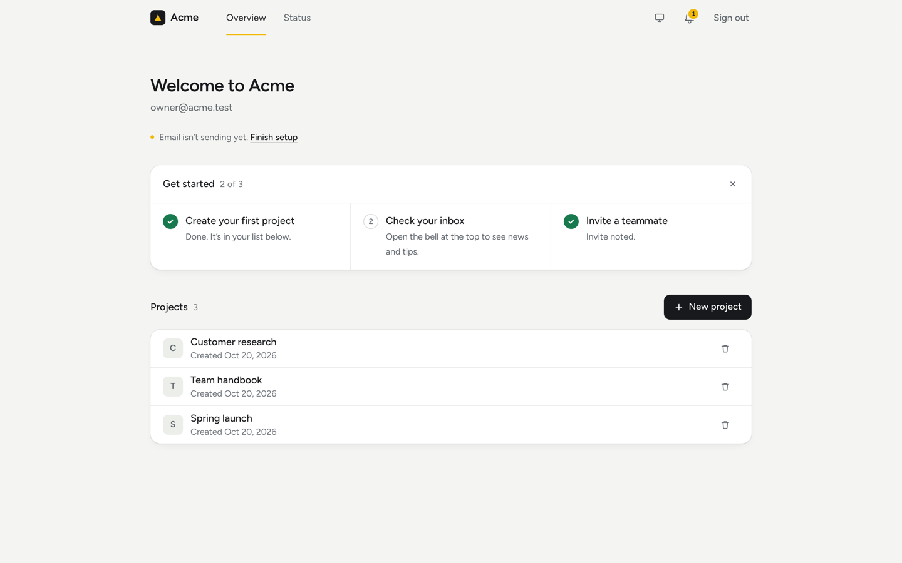

# Next.js SaaS starter with Customer.io

A small SaaS app you can deploy in one click and make your own:

- **Email sign-in** with a magic link (Auth.js). No passwords.
- **Postgres on Neon**, added for you when you deploy.
- **Customer.io** for the sign-in email, a welcome email, a note to you for each signup, page views, and in-app messages with an inbox.
- **A small dashboard** with one example resource ("projects") and a "Get started" checklist. Every action sends a Customer.io event.

The app is called **Acme**, a placeholder. Change the name and logo in `lib/site.ts` and `components/logo.tsx`.

[](https://vercel.com/new/clone?repository-url=https%3A%2F%2Fgithub.com%2Fcustomerio%2Fnextjs-saas-starter&integration-ids=oac_87hWAXW9Pa4LMmmqpHzszxtH&products=%5B%7B%22type%22%3A%22integration%22%2C%22integrationSlug%22%3A%22neon%22%2C%22productSlug%22%3A%22neon%22%2C%22protocol%22%3A%22storage%22%7D%5D&env=AUTH_SECRET&envDescription=A%20random%20secret%20for%20Auth.js.%20Run%20%60npx%20auth%20secret%60%20or%20%60openssl%20rand%20-base64%2033%60%20and%20paste%20the%20value.&envLink=https%3A%2F%2Fauthjs.dev%2Fgetting-started%2Finstallation%23setup-environment&project-name=acme-saas&repository-name=acme-saas)

| Landing page                                          | Sign-in, before email is set up                                              |
| ----------------------------------------------------- | ---------------------------------------------------------------------------- |
|          |  |
| **Dashboard**                                         | **Status page**                                                              |
|  |                         |

## Deploy

1. Click **Deploy with Vercel**. Vercel adds **Customer.io** (connects a workspace and writes the `CUSTOMERIO_*` variables) and **Neon** (creates the database).
2. Vercel asks for one value, **`AUTH_SECRET`**. Make one with `npx auth secret` or `openssl rand -base64 33`.
3. Vercel builds the app. The build creates the database tables first.

The person who installed the integration is the **owner**. Their email is written as `CUSTOMERIO_OWNER_EMAIL`. To pick someone else, set `OWNER_EMAIL`.

## First sign-in after deploying

A new Customer.io workspace can't send email yet, so your first link won't arrive by email. That is normal.

1. Open your site, go to **Sign in**, and type the owner's email.
2. In Vercel, open your project, then **Logs**. Find the line that starts with `[acme] Owner sign-in link`.
3. Open that link in the same browser. You're signed in.
4. Open **`/status`** to see what is left before email can send.

Only the owner's link is logged, and only while email can't go out. Links work once and expire after 15 minutes.

## Turn on email

`/status` walks you through these steps and checks them for you:

1. **Confirm the account owner's email** from the message Customer.io sent you.
2. **Get the account approved for sending.** See [account verification](https://docs.customer.io/accounts/account-verification/).
3. **Verify a sending domain.** See [domain authentication](https://docs.customer.io/messaging/channels/email/deliverability/authentication/).
4. **Turn off test mode** in your workspace settings: pick **Send messages normally**. Until then, email only reaches the account owner.

While email is off, visitors see "Sign-in emails aren't on yet" and are saved as leads. Once a send works, everything turns on by itself.

## Environment variables

| Variable                   | Set by      | What it is for                                                 |
| -------------------------- | ----------- | -------------------------------------------------------------- |
| `AUTH_SECRET`              | You         | Signs Auth.js cookies and link tokens.                         |
| `DATABASE_URL`             | Neon        | Pooled Postgres URL for the app.                               |
| `DATABASE_URL_UNPOOLED`    | Neon        | Direct Postgres URL for migrations.                            |
| `CUSTOMERIO_SITE_ID`       | Customer.io | Track API site ID.                                             |
| `CUSTOMERIO_TRACK_API_KEY` | Customer.io | Track API key (server only).                                   |
| `CUSTOMERIO_APP_API_KEY`   | Customer.io | Sends email. Production and Preview only.                      |
| `CUSTOMERIO_CDP_WRITE_KEY` | Customer.io | Browser SDK key: page views, in-app messages, inbox. Public.   |
| `CUSTOMERIO_REGION`        | Customer.io | `us` or `eu`. Picks the API hosts.                             |
| `CUSTOMERIO_WORKSPACE_ID`  | Customer.io | Links the status page to your workspace.                       |
| `CUSTOMERIO_OWNER_EMAIL`   | Customer.io | The owner: can open `/status` and gets a note for each signup. |
| `OWNER_EMAIL`              | You         | Optional. Overrides the owner.                                 |
| `CUSTOMERIO_FROM_EMAIL`    | You         | Optional. Sender address on your verified domain.              |

More optional settings (your own email designs, for example) are in [`.env.example`](.env.example). `/status` shows which variables are set, never their values.

## Events

The app sends `signup_started`, `signed_up`, `project_created`, `project_deleted`, `teammate_invited`, `onboarding_step_completed`, and `onboarding_completed`, plus page views from the browser. Build campaigns on them in Customer.io. The full list, with properties and campaign ideas, is in [how it works](docs/how-it-works.md#events-this-app-sends).

## Local development

You need Node.js 24, pnpm, and Postgres. With [mise](https://mise.jdx.dev), `mise install` sets up the pinned Node and pnpm.

```sh
docker run -d --name acme-postgres -e POSTGRES_PASSWORD=acme -p 5432:5432 postgres:17
cp .env.example .env.local   # already points at this database
pnpm install
pnpm db:migrate
pnpm dev
```

Open http://localhost:3000 and sign in. Locally no email goes out: **your sign-in link prints in the terminal**. Without `CUSTOMERIO_*` variables the app still runs and skips the Customer.io calls. To try the whole flow without a workspace, use the fake Customer.io in [`scripts/fake-customerio.mjs`](scripts/fake-customerio.mjs).

Other scripts: `pnpm lint`, `pnpm typecheck`, `pnpm test`, `pnpm db:generate` (after you change `lib/db/schema.ts`), and `pnpm screenshots`.

## Make it yours

- **Name and logo:** `lib/site.ts`, `components/logo.tsx`, `app/icon.svg`.
- **Colors:** the tokens at the top of `app/globals.css`.
- **Emails:** `lib/customerio/emails.ts`, or design them in Customer.io (see `.env.example`).
- **The example resource:** rename it in `lib/site.ts`, then replace it with your feature in `app/(app)/dashboard/` and `lib/flows/projects.ts`.
- **Tables:** edit `lib/db/schema.ts`, run `pnpm db:generate`, and commit the new file in `drizzle/`.

How the flows, rules, and code are put together: [docs/how-it-works.md](docs/how-it-works.md).

## License

[MIT](LICENSE)
